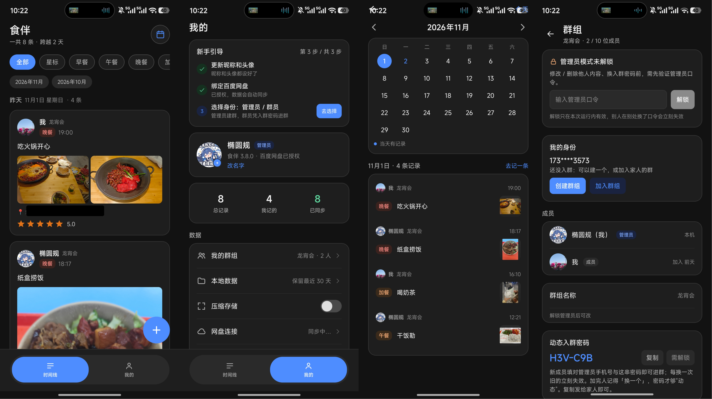
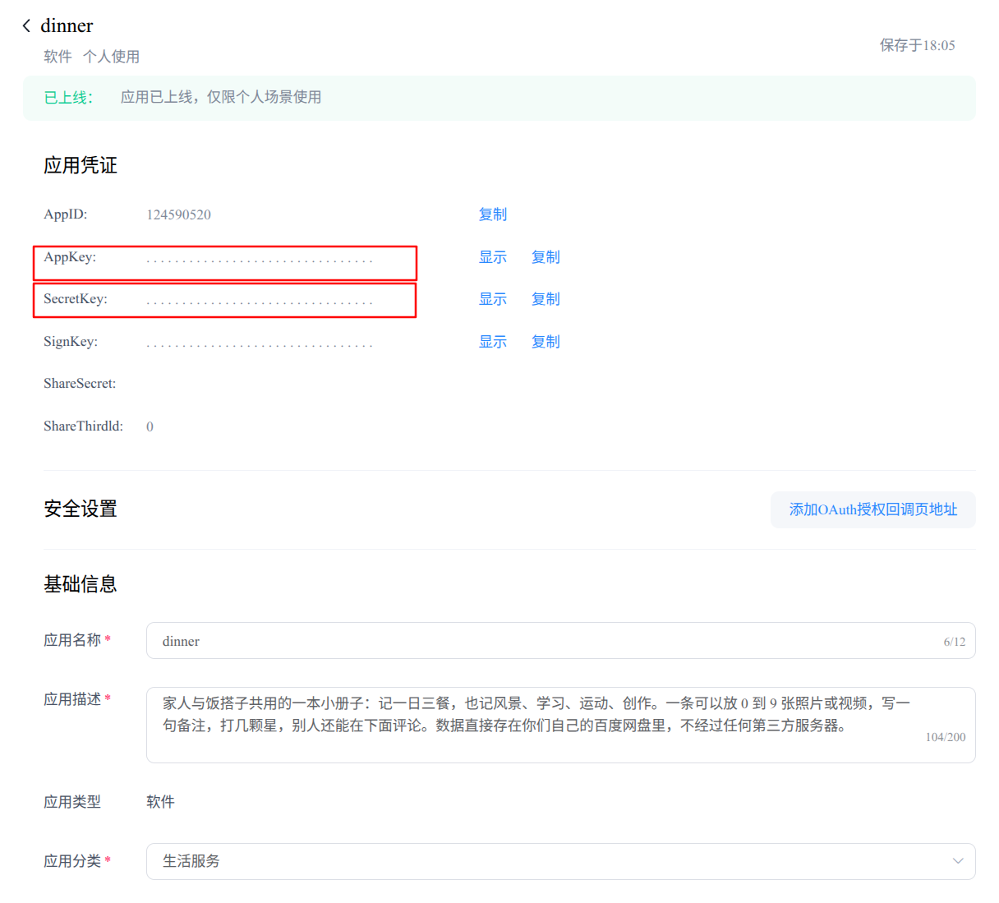

# 食伴 (dinner)｜私有的小册子

[English](README_EN.md) | [简体中文](README.md)

> 食伴记一日三餐，也记晚霞、学习、运动、创作和风景。  
> 把三餐和日子，记在我们自己的小册子里。  
> 不需要点赞，不需要给谁看，更不想让两个人的日常变成被围观的动态。
>
> **数据安全**：数据直接存储在你自己控制的**百度网盘**中，不经过食伴（dinner）或任何第三方服务器。  
> **数据隐私**：一本私有的小册子，只有我们两个能打开。  
> **数据保留**：不受即时通讯软件 7 天/30 天备份或保留期限的限制。
>
> **把三餐和日子，记在我们自己的小册子里。**

## 开发初衷

开发**食伴（dinner）**，最初只是一个小小的私心：想每天和女朋友（PXX）留下一点共同的记录。

我们每天都会吃饭，也都会遇到一些值得说一句的小事——今天各自吃了什么、傍晚的风景很好看、晚上跑了步、学了一会儿，或者一起写了一半的歌。这些事情单独看都很轻，但攒在一起，就是我们两个人的日子。最初只是想记下“今天有没有好好吃饭”，后来慢慢发现，想记的不只是三餐，还有饭桌以外的风景、学习、运动和创作。

也不想把这些发在社交平台上。不需要点赞，不需要给谁看，更不想让两个人的日常变成被围观的动态。所以食伴从一开始就是一本私有的小册子：数据直接存在我们自己的百度网盘里，不经过食伴或任何第三方服务器，只有我们两个能打开。它像一个共同的餐桌，也像一份日子的底稿——各自忙碌的时候，打开它，就像在同一个餐桌旁碰了个面。

所以有了食伴：记一日三餐，也记晚霞、学习、运动、创作和风景。把三餐和日子，记在我们自己的小册子里。

## 目录

- [项目信息](#项目信息)
- [功能特色](#功能特色)
- [界面参考](#界面参考)
- [使用指南](#使用指南)
- [环境要求](#环境要求)
- [命令行构建与安装](#命令行构建与安装)
- [贡献](#贡献)
- [开发者声明](#开发者声明)
- [许可](#许可)

## 项目信息

| 项目   | 内容                                                              |
| ------ | ----------------------------------------------------------------- |
| 版本   | 1.0.0                                                             |
| 包名   | `com.guolongli.dinner`（debug 包为 `com.guolongli.dinner.debug`） |
| 技术栈 | Kotlin + Jetpack Compose                                          |
| 存储   | 需百度网盘（Baidu Netdisk）授权，默认目录 `/apps/dinner/`         |
| 开发者 | Guolong Li <guolongli_upc@foxmail.com>                            |
| 协议   | MIT                                                               |

## 功能特色

| 功能     | 说明                                                                                           |
| -------- | ---------------------------------------------------------------------------------------------- |
| 时间线   | 按天分组，显示总条数与跨越天数；卡片预览九宫格媒体、备注、评分与评论                           |
| 索引     | 全部 / 星标 / 九种类型筛选常驻；跨月显示月份条，点击跳转                                       |
| 日历     | 月历标出有记录日期，点选只看当天；只读本地，不耗接口配额                                       |
| 记录类型 | 早 / 午 / 晚 / 加餐 + 风景 / 学习 / 运动 / 创作 / 其他                                         |
| 多媒体   | 单条 0–9 段媒体，照片视频混排；照片统一转 JPEG（HEIF / AVIF 也可读取）                         |
| 视频     | 九宫格显示封面帧与时长，点开全屏播放                                                           |
| 压缩存储 | 一个开关同时管理照片和视频，默认关闭；开启后照片长边 1920、视频 1280；转码失败保留原片         |
| 评论     | 记录下可评论，删除同步；卡片预览最近两条                                                       |
| 成员     | 管理员口令 + 动态入群密码；成员上限 10 人，每人独立身份与头像                                  |
| 口令     | 两份口令以明文存储在云端（产品要求）；管理员操作需在群组页输入口令，解锁仅在本次运行内存中有效 |
| 删除     | 只删本地 / 只删云端 / 都删，二次确认；只能删自己上传的云端文件                                 |
| 管理员   | 可修改、删除所有记录与评论，可转让；后端统一权限校验                                           |
| 应用锁   | 打开时用指纹 / 人脸 / 锁屏密码验证，应用不保存口令                                             |
| 统计     | 总记录 / 我记的 / 已同步三个数字可点，进入明细列表                                             |
| 本地保留 | 默认 30 天，可调 7 / 30 / 90 / 180 / 永久；清理前确认云端有副本                                |
| 区间取回 | 选时间段从云端补回记录与评论，也可取回全部；照片视频点开时再下载，不耗接口配额                 |
| 网盘重试 | 可设 1 / 2 / 3 / 5 次，默认 3 次；仅重试频控与断网等瞬时故障                                   |
| 自动取回 | 授权、配对、绑定手机号后自动拉取云端历史；进时间线先拉后推                                     |
| 离线优先 | 先写本地，联网自动补传；失败标记，可手动重试                                                   |

## 界面参考



## 使用指南

进入 [**百度网盘开放平台**](https://pan.baidu.com/union/console/applist)，注册帐号；选择个人开发者即可，软件名称填写 **dinner**（不能修改），获得 `AppKey` 和 `SecretKey`。



注意：`AppKey` 和 `SecretKey` 仅应分享给特定的人；它们会以明文形式存储在百度网盘中（产品要求），以避免忘记口令后无法取回数据。请妥善保管。

## 环境要求

| 软件        | 版本                         | 说明                                                       |
| ----------- | ---------------------------- | ---------------------------------------------------------- |
| JDK         | 17 或更高                    | AGP 9.x 需要（Temurin / OpenJDK 17 均可）                  |
| Android SDK | platform 35 + build-tools 35 | `compileSdk 35`，`minSdk 28`（Android 9+），`targetSdk 35` |
| Gradle      | 8.9 或更高                   | `scripts/build.sh`                                         |

无需安装 Android Studio：只要有 JDK、Android SDK 命令行工具和 Gradle，即可完成构建与安装。

## 命令行构建与安装

### 第 1 步：准备 Android SDK（只需一次）

```bash
# 目录可以随意换，下文以 ~/android-sdk 为例
mkdir -p ~/android-sdk/cmdline-tools && cd ~/android-sdk/cmdline-tools

# 从 https://developer.android.com/studio#command-tools 下载 commandlinetools-linux-*.zip 后：
unzip commandlinetools-linux-*.zip
mv cmdline-tools latest   # 让 sdkmanager 位于 cmdline-tools/latest/bin

export ANDROID_SDK_ROOT=~/android-sdk
yes | $ANDROID_SDK_ROOT/cmdline-tools/latest/bin/sdkmanager --licenses
$ANDROID_SDK_ROOT/cmdline-tools/latest/bin/sdkmanager \
  "platform-tools" "platforms;android-35" "build-tools;35.0.0"
```

把 `export ANDROID_SDK_ROOT=...` 写进 `~/.bashrc`，后续就不用每次设置。

### 第 2 步：打包 debug 与 release

日常开发用 `build.sh` 就够。要出两个可安装的成品包（自己用一份、发给对方一份），用 `package.sh`：

```bash
./scripts/package.sh              # debug + release
./scripts/package.sh release      # 只出 release
./scripts/package.sh debug        # 只出 debug
./scripts/package.sh all --clean  # 先 clean 再全量构建
```

产物按版本号命名，多个版本可以并存：

```text
apk/dinner-3.8.0-debug.apk       applicationId: com.guolongli.dinner.debug
apk/dinner-3.8.0-release.apk     applicationId: com.guolongli.dinner
```

每种构建还会额外留一份固定名字的副本，方便直接发给人安装（永远指向最新一次构建）：

```text
apk/dinner.apk                   debug 包
apk/dinner-release.apk           release 包
```

debug 与 release 的包名不同，可以同时装在手机上；桌面图标相同，认名字里的版本号区分。

release 目前不做代码混淆与资源压缩（`isMinifyEnabled = false`），只做正式签名与去掉 debug 后缀，便于对照排查问题。

首次安装需在系统设置里允许「安装未知来源应用」。

## 贡献

本项目在人工智能辅助下开发与完善，难免存在不足，欢迎提交问题报告和功能请求。如果你想贡献代码，请：

1. Fork 本项目
2. 创建功能分支
3. 提交更改
4. 发起 Pull Request

提交前建议简要说明复现步骤、设备型号、系统版本与应用版本，便于定位问题。

## 开发者声明

> **⚠️ 使用前请阅读：** 本项目按“现状”提供，开发者不承担数据损失等责任；**强烈建议在更新版本前备份好数据**。

本项目基于 **MIT License** 开源发布。本声明是对 MIT License 免责条款的补充说明，不改变、不替代其条款；如有冲突，以 MIT License 为准。

### 1. 按“现状”提供

本应用按“现状”（AS IS）和“现有”（AS AVAILABLE）提供，不附带任何明示或默示担保。开发者不保证应用无错误、无中断、无漏洞，也不保证其与任何设备、系统、网络或第三方服务兼容。使用风险由你自行承担。

### 2. 不承担数据损失等责任

在法律允许的最大范围内，开发者、贡献者及版权持有人不对因使用本应用产生的任何损害承担责任，包括但不限于：

- 饮食记录、照片、视频、评论、评分、备注及本地数据库等数据的丢失、损坏、不可恢复或无法访问；
- 因版本更新、覆盖安装、卸载、本地保留策略清理、压缩转码、同步失败或重试耗尽导致的数据问题；
- 因百度网盘或其他第三方服务变更、频控、故障、关停、账号异常或授权失效导致的数据无法上传、下载、取回或同步；
- 因设备故障、系统升级、误操作、存储损坏、网络中断或不可抗力导致的数据损失；
- 间接损失、附带损失、特殊损失、惩罚性损失或后果性损失；
- 因群组成员操作或管理员权限行使导致的内容变化或数据不可用。

### 3. 备份是你的责任

**强烈建议在更新版本前备份好数据**，并为重要记录保留多份副本。应用提供的“云端副本确认”“区间取回”“自动取回”等机制不是备份方案，不能替代独立备份。

### 4. 第三方服务

主要数据直接存储在你个人控制的百度网盘中，不经过开发者服务器或中间第三方服务器。百度网盘的服务可用性、数据安全、接口稳定性和存储策略由其运营方独立决定，开发者不对百度网盘侧的数据状态承担责任。使用百度网盘还应遵守其自身服务条款。

### 5. 用户责任

你应妥善保管百度网盘账号、群组口令和管理员口令；确保上传内容合法合规、不侵犯他人权利；理解删除档位、本地保留策略及管理员权限设计的后果，并自行做好备份。

### 6. 衍生作品与条款

修改、分发或部署本项目代码，应遵守 MIT License（保留版权声明与许可声明），并自行承担相关责任。开发者不对第三方衍生版本负责。本声明任何条款无效或不可执行，不影响其余条款效力。

下载、安装、使用或继续使用本应用，即视为你已阅读、理解并同意本声明及 MIT License。

## 许可

本项目采用 MIT License，详见 [LICENSE](LICENSE)。
