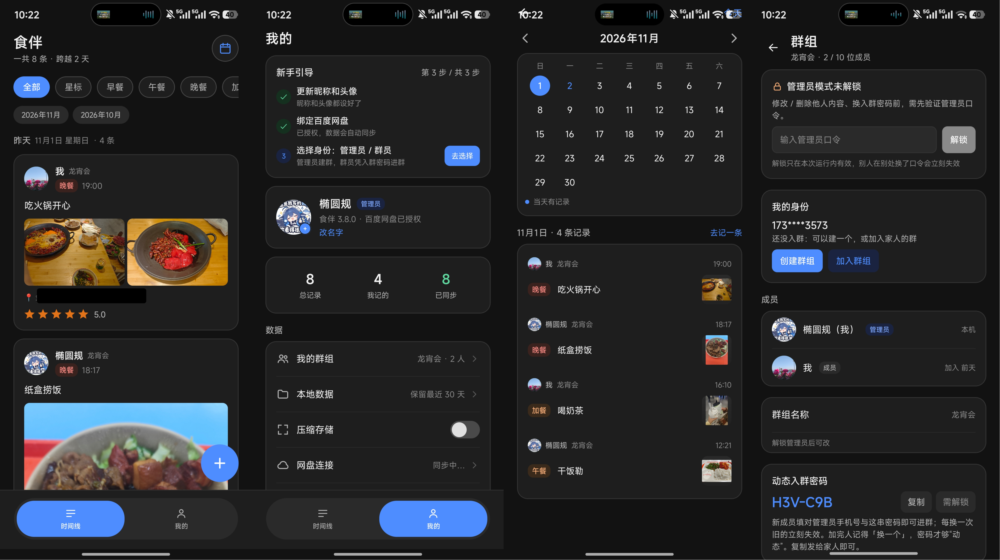
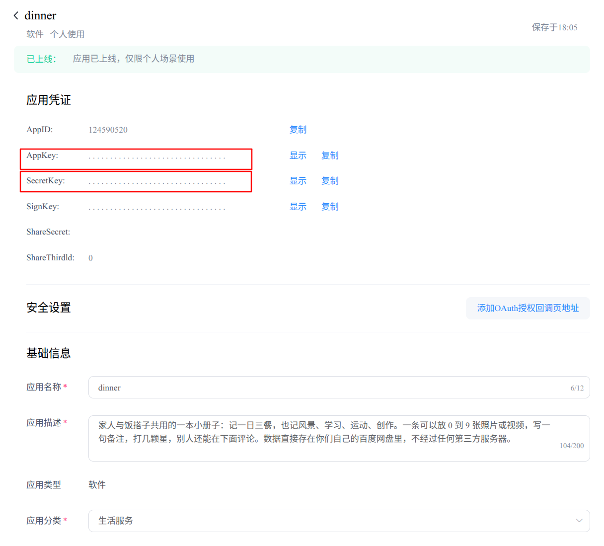

# ShiBan (dinner) | A Private Notebook

> ShiBan records your three meals a day, along with sunsets, study sessions, exercise, creative work, and scenery.  
> Keep your meals and your days in your own little notebook.  
> No likes, no audience, no turning your daily life into a public feed.
>
> **Data security**: Your data is stored directly in the **Baidu Netdisk** you control, without passing through ShiBan (dinner) or any third-party server.  
> **Data privacy**: A private notebook that only the two of you can open.  
> **Data retention**: Free from the 7-day/30-day backup or retention limits of instant messaging apps.
>
> **Keep your meals and your days in your own little notebook.**

## Development Motivation

ShiBan (dinner) started as a small, personal wish: to leave a shared record with my girlfriend (PXX) every day.

We eat every day, and every day there are small things worth noting—what each of us ate, a beautiful view at dusk, a run in the evening, a study session, or a song we started writing together. Individually, these things are light; together, they become our days. At first, I only wanted to record "did we eat well today?" Later, I realized I wanted to record more than meals: scenery, study, exercise, and creative work beyond the table.

I also didn't want to post these things on social platforms. No likes, no audience, no turning our daily life into a public feed. So ShiBan was designed from the start as a private notebook: data is stored directly in our own Baidu Netdisk, without passing through ShiBan or any third-party server, and only the two of us can open it. It is like a shared table, and also a draft of our days—when we are busy, opening it feels like meeting at the same table.

That is how ShiBan came to be: it records three meals a day, along with sunsets, study, exercise, creative work, and scenery. Keep your meals and your days in your own little notebook.

## Table of Contents

- [Project Information](#project-information)
- [Features](#features)
- [Screenshots](#screenshots)
- [Usage Guide](#usage-guide)
- [Requirements](#requirements)
- [Build and Install from the Command Line](#build-and-install-from-the-command-line)
- [Contributing](#contributing)
- [Developer Disclaimer](#developer-disclaimer)
- [License](#license)

## Project Information

| Item       | Details                                                                 |
| ---------- | ----------------------------------------------------------------------- |
| Version    | 1.0.0                                                                   |
| Package    | `com.guolongli.dinner` (debug: `com.guolongli.dinner.debug`)            |
| Tech Stack | Kotlin + Jetpack Compose                                                |
| Storage    | Requires Baidu Netdisk authorization; default directory `/apps/dinner/` |
| Developer  | Guolong Li <guolongli_upc@foxmail.com>                                  |
| License    | MIT                                                                     |

## Features

| Feature            | Description                                                                                                                                                                                          |
| ------------------ | ---------------------------------------------------------------------------------------------------------------------------------------------------------------------------------------------------- |
| Timeline           | Grouped by day, with total entry count and days spanned; cards preview a 3x3 media grid, notes, ratings, and comments                                                                                |
| Index              | Persistent filters for All / Starred / Nine types; a month bar appears across months and jumps to that month on tap                                                                                  |
| Calendar           | A monthly calendar marks days with entries; tap a day to view only that day. Read-only local data, no API quota consumed                                                                             |
| Entry Types        | Breakfast / Lunch / Dinner / Snack + Scenery / Study / Exercise / Creation / Other                                                                                                                   |
| Media              | 0–9 media items per entry, photos and videos mixed; photos are converted to JPEG (HEIF / AVIF supported)                                                                                             |
| Video              | 3x3 grid shows cover frame and duration; tap to play full screen                                                                                                                                     |
| Compressed Storage | One switch controls both photos and videos; off by default. When on, photos are resized to 1920 px on the long edge and videos to 1280 px; if transcoding fails, the original file is kept           |
| Comments           | Comments can be added under each entry and deletions sync; cards preview the latest two                                                                                                              |
| Members            | Admin password + dynamic join password; up to 10 members, each with an independent identity and avatar                                                                                               |
| Passwords          | Both passwords are stored in plaintext in the cloud (product requirement); admin actions require entering the password on the Group page, and the unlock is valid only in the current process memory |
| Deletion           | Local only / Cloud only / Both, with a second confirmation; you can only delete cloud files you uploaded                                                                                             |
| Administrator      | Can edit and delete all entries and comments, and transfer ownership; permissions are enforced on the backend                                                                                        |
| App Lock           | Unlock with fingerprint / face / screen lock password; the app does not store any passwords                                                                                                          |
| Statistics         | Three tappable numbers at the top of "Me": Total Entries / Mine / Synced, opening a detail list                                                                                                      |
| Local Retention    | Keep the last 30 days by default (adjustable to 7 / 30 / 90 / 180 / Forever); confirm cloud copies before cleanup                                                                                    |
| Range Retrieval    | Select a date range to restore entries and comments from the cloud, or retrieve all; photos and videos download on demand, saving API quota                                                          |
| Netdisk Retry      | Set 1 / 2 / 3 / 5 retries (default 3); only transient failures such as rate limiting and network disconnection are retried                                                                           |
| Auto Retrieval     | Automatically pulls cloud history after authorization, pairing, or phone binding; entering the timeline pulls first, then pushes                                                                     |
| Offline First      | Writes to the local database first and uploads automatically when online; failures are marked and can be retried manually                                                                            |

## Screenshots



## Usage Guide

Go to the [**Baidu Netdisk Open Platform**](https://pan.baidu.com/union/console/applist) and register an account. Choose the individual developer option. Enter **dinner** as the software name (this cannot be changed) to obtain `AppKey` and `SecretKey`.



Note: Share `AppKey` and `SecretKey` only with specific people. They are stored in plaintext in Baidu Netdisk (a product requirement) to avoid the situation where forgotten passwords make data unrecoverable. Please keep them secure.

## Requirements

| Software    | Version                      | Notes                                                     |
| ----------- | ---------------------------- | --------------------------------------------------------- |
| JDK         | 17 or higher                 | Required by AGP 9.x (Temurin / OpenJDK 17 both work)      |
| Android SDK | platform 35 + build-tools 35 | `compileSdk 35`, `minSdk 28` (Android 9+), `targetSdk 35` |
| Gradle      | 8.9 or higher                | `scripts/build.sh`                                        |

Android Studio is not required: as long as you have JDK, Android SDK command-line tools, and Gradle, you can build and install the app.

## Build and Install from the Command Line

### Step 1: Prepare the Android SDK (once)

```bash
# The directory can be changed; ~/android-sdk is used as an example below
mkdir -p ~/android-sdk/cmdline-tools && cd ~/android-sdk/cmdline-tools

# After downloading commandlinetools-linux-*.zip from https://developer.android.com/studio#command-tools:
unzip commandlinetools-linux-*.zip
mv cmdline-tools latest   # so that sdkmanager is at cmdline-tools/latest/bin

export ANDROID_SDK_ROOT=~/android-sdk
yes | $ANDROID_SDK_ROOT/cmdline-tools/latest/bin/sdkmanager --licenses
$ANDROID_SDK_ROOT/cmdline-tools/latest/bin/sdkmanager \
  "platform-tools" "platforms;android-35" "build-tools;35.0.0"
```

Add `export ANDROID_SDK_ROOT=...` to `~/.bashrc` so you don't need to set it every time.

### Step 2: Package debug and release builds

For daily development, `build.sh` is enough. To produce two installable packages (one for yourself and one to send to the other person), use `package.sh`:

```bash
./scripts/package.sh              # debug + release
./scripts/package.sh release      # release only
./scripts/package.sh debug        # debug only
./scripts/package.sh all --clean  # clean first, then build everything
```

Artifacts are named by version, and multiple versions can coexist:

```text
apk/dinner-3.8.0-debug.apk       applicationId: com.guolongli.dinner.debug
apk/dinner-3.8.0-release.apk     applicationId: com.guolongli.dinner
```

Each build also leaves a fixed-name copy for easy sharing (always pointing to the latest build):

```text
apk/dinner.apk                   debug package
apk/dinner-release.apk           release package
```

Debug and release have different package names, so they can be installed on the same phone. The desktop icon is the same; use the version number in the name to tell them apart.

Release builds currently do not enable code obfuscation or resource shrinking (`isMinifyEnabled = false`); they only apply official signing and remove the debug suffix, making troubleshooting easier.

On first installation, you need to allow "Install unknown apps" in the system settings.

## Contributing

This project was developed and improved with the assistance of AI, and there may still be imperfections. Issue reports and feature requests are welcome. If you would like to contribute code, please:

1. Fork this project
2. Create a feature branch
3. Commit your changes
4. Open a Pull Request

Before submitting, please briefly describe the reproduction steps, device model, system version, and app version to help us locate the issue.

## Developer Disclaimer

> **⚠️ Please read before use:** This project is provided "AS IS"; the developer assumes no liability for data loss or other damages. **Back up your data before updating the app.**

This project is open-sourced under the **MIT License**. This disclaimer supplements the warranty disclaimer in the MIT License. It does not modify or replace the MIT License; in case of conflict, the MIT License prevails.

### 1. Provided "AS IS"

This app is provided "AS IS" and "AS AVAILABLE", without any express or implied warranties. The developer does not guarantee that the app will be error-free, uninterrupted, or free of vulnerabilities, nor that it will be compatible with any device, system, network, or third-party service. You use it at your own risk.

### 2. No Liability for Data Loss or Other Damages

To the maximum extent permitted by law, the developer, contributors, and copyright holders are not liable for any damages arising from the use of this app, including but not limited to:

- Loss, corruption, unrecoverability, or inaccessibility of meal records, photos, videos, comments, ratings, notes, local databases, or any other data;
- Data issues caused by version updates, overwrite installations, uninstallation, local retention cleanup, compressed transcoding, sync failures, or exhausted retries;
- Inability to upload, download, retrieve, or sync data due to changes, rate limiting, failures, shutdowns, account anomalies, or authorization expiration of Baidu Netdisk or other third-party services;
- Data loss caused by device failure, system upgrades, mistaken operations, storage corruption, network interruptions, or force majeure;
- Indirect, incidental, special, punitive, or consequential damages;
- Changes to content or unavailability of data caused by actions of group members or the exercise of administrator permissions.

### 3. Backup Is Your Responsibility

**Strongly recommended: back up your data before updating the app**, and keep multiple copies of important records. Features such as "cloud copy confirmation", "range retrieval", and "auto retrieval" are not backup solutions and cannot replace independent backups.

### 4. Third-Party Services

Primary data is stored directly in the Baidu Netdisk you control, without passing through the developer's servers or any intermediary third-party server. The availability, data security, API stability, and storage policies of Baidu Netdisk are determined independently by its operator. The developer is not responsible for the state of data on the Baidu Netdisk side. Your use of Baidu Netdisk is also subject to its own terms of service.

### 5. User Responsibilities

You are responsible for safeguarding your Baidu Netdisk account, group passwords, and admin password; ensuring that uploaded content is legal and does not infringe on the rights of others; understanding the consequences of the deletion options, local retention policies, and administrator permission design; and making your own backups.

### 6. Derivative Works and Severability

If you modify, distribute, or deploy the project code, you must comply with the MIT License (retain the copyright and license notices) and bear all related responsibilities. The developer is not responsible for third-party derivative versions. If any provision of this disclaimer is invalid or unenforceable, the remaining provisions remain in effect.

By downloading, installing, using, or continuing to use this app, you acknowledge that you have read, understood, and agreed to this disclaimer and the MIT License.

## License

This project is licensed under the MIT License. See [LICENSE](LICENSE) for details.
